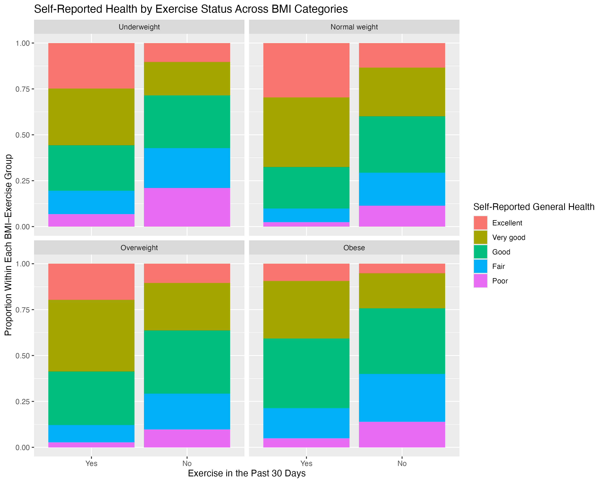
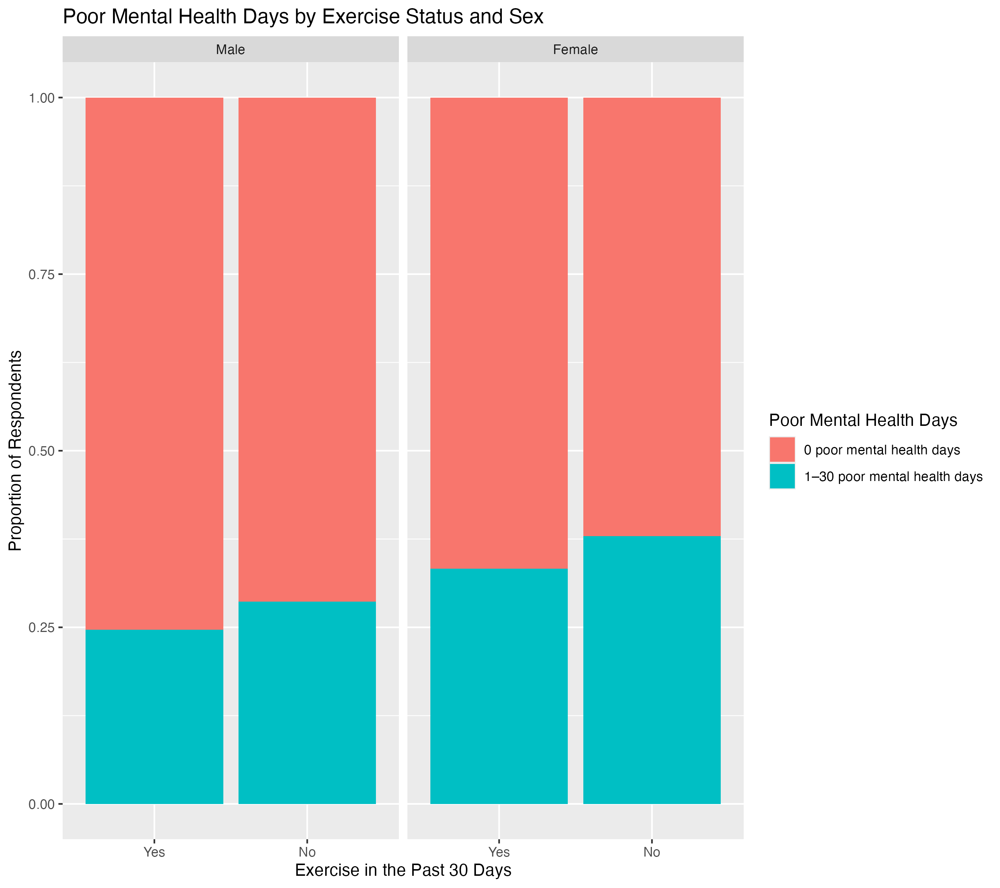
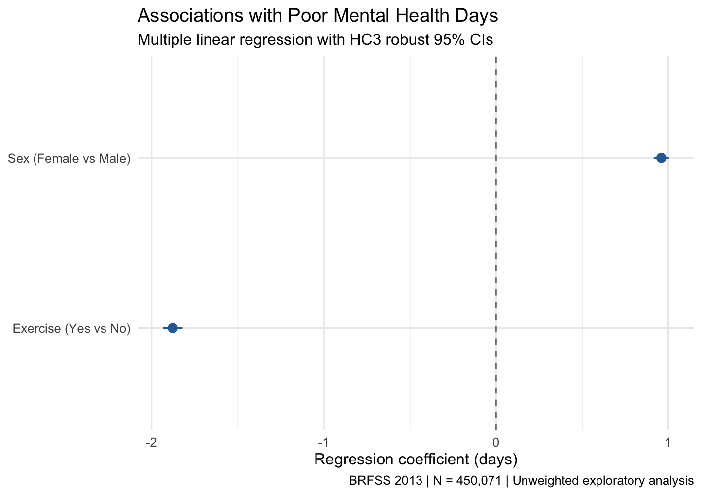
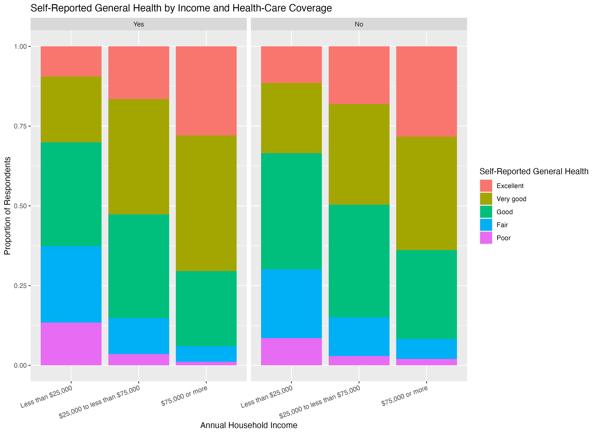

# BRFSS 2013 Health Analysis

This ia an exploratory data analysis project using the 2013 Behavioral Risk Factor Surveillance System (BRFSS) dataset. This project examines associations between exercise, body mass index (BMI), mental health, household income, health-care coverage, and self-reported general health among U.S. adults.

## Project Overview

This project was completed as part of the Duke University *Introduction to Probability and Data with R* course. It demonstrates a basic end-to-end R workflow: data cleaning, descriptive statistics, grouped summaries, data visualization, and interpretation of observational survey data.

The analysis uses `dplyr` for data wrangling and `ggplot2` for visualization.

## Dataset and Study Design

The 2013 BRFSS is a large probability-based telephone survey of non-institutionalized U.S. adults aged 18 years and older. Data were collected through landline and cellular telephone interviews.

Because BRFSS is an observational survey, the findings describe associations rather than causal effects. Potential limitations include nonresponse bias, telephone undercoverage, self-report bias in exercise, health, height, and weight, and possible bias from excluding observations with missing values.

The raw dataset is not included in this repository. It was supplied through course materials and is excluded from version control through `.gitignore`.

## Research Questions

### RQ1: Exercise, BMI, and self-reported health

How does self-reported general health differ between adults who did and did not exercise in the past 30 days, across BMI categories?

Across all BMI categories, respondents who exercised in the past 30 days had a higher proportion reporting Excellent or Very good health and a lower proportion reporting Fair or Poor health than non-exercisers. For example, among respondents with normal weight, 67.4% of exercisers reported Excellent or Very good health, compared with 39.8% of non-exercisers. The obese non-exercising group had the highest proportion reporting Fair or Poor health (40.1%).

### RQ2: Exercise, sex, and poor mental health days

How does the number of poor mental health days in the past 30 days differ by recent exercise status and sex among U.S. adults?

**Descriptive Analysis**

The median number of poor mental health days was zero in all groups, so the proportion reporting zero poor mental health days provided a clearer comparison. Among males, 75.4% of exercisers and 71.3% of non-exercisers reported zero poor mental health days. Among females, the corresponding proportions were 66.7% and 62.1%. Female non-exercisers had the highest mean number of poor mental health days (5.2 days).

**Multiple Linear Regression**

A multiple linear regression was conducted to examine the associations of exercise status and sex with poor mental health days (N = 450,071). HC3 heteroskedasticity-robust standard errors were used for statistical inference.

  

| Predictor | β | Robust SE | p-value |
|---|---:|---:|---:|
| Exercise (Yes vs. No) | -1.878 | 0.029 | < 0.001 |
| Sex (Female vs. Male) | 0.959 | 0.023 | < 0.001 |

*R² = 0.0162.*

After accounting for sex, respondents reporting recent exercise had, on average, 1.88 fewer poor mental health days than non-exercisers. After accounting for exercise status, female respondents reported approximately 0.96 more poor mental health days than male respondents.

Although both associations were statistically significant, the model explained only 1.62% of the variance. These findings are exploratory and do not establish causality. The analysis did not adjust for additional potential confounders or the complex BRFSS sampling design.

### RQ3: Income, health-care coverage, and self-reported health

How does self-reported general health differ across household income categories among adults with and without health-care coverage?

Self-reported health showed a clear income gradient within both health-care coverage groups. Among respondents with coverage, the proportion reporting Excellent or Very good health increased from 30.1% in the lowest income group to 70.5% in the highest income group. Among respondents without coverage, the same proportion increased from 33.5% to 63.9%.

The relationship between health-care coverage and self-reported health was not consistent within income groups. This should not be interpreted causally, as age, employment, existing health conditions, and other unmeasured factors may influence both health-care coverage and self-reported health.

## Methods

The analysis includes:

- Data screening and complete-case analysis for each research question
- Removal of invalid values, such as `menthlth = 5000` for a variable defined as the number of poor mental health days in the past 30 days
- Descriptive statistics including sample size, proportions, means, medians, and interquartile ranges
- Grouped comparisons using `group_by()` and `summarise()`
- Proportional stacked bar charts and faceted visualizations
- Interpretation of generalizability, bias, confounding, and causal limitations
